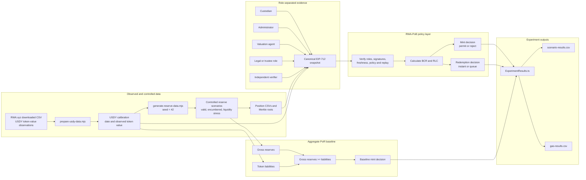

# RWA-PoB: Credential-Based Proof of Backing for Tokenized U.S. Treasuries

[](https://github.com/rischanlab/PoB/actions/workflows/ci.yml)
[](LICENSE)

This repository contains the research prototype and reproducibility package for
**RWA-PoB**, a credential-based proof-of-backing policy framework for tokenized
short-duration U.S. Treasury products.

The prototype compares:

1. **Aggregate Proof of Reserves (PoR):** checks whether reported gross reserves
   cover reported token liabilities.
2. **RWA-PoB:** verifies a common reserve snapshot signed by required
   institutional roles, calculates eligible backing and redemption liquidity,
   and applies explicit minting and redemption policies.

> **Research disclaimer:** This repository is not an audit of USDY, does not
> reconstruct USDY's actual reserve portfolio, and is not production-ready
> financial software. Public USDY observations are used only to calibrate the
> scale of token liabilities. Position-level reserve, encumbrance, legal,
> settlement, liquidity, and credential states are controlled experimental data.

## Main contributions implemented

- EIP-712 signatures from five required institutional roles:
  - custodian;
  - administrator;
  - valuation agent;
  - legal or trustee role; and
  - independent verifier.
- A canonical snapshot containing:
  - reporting epoch and timestamps;
  - reserve Merkle root;
  - policy hash;
  - gross and eligible reserves;
  - liquid assets;
  - token liabilities;
  - pending redemptions; and
  - other liabilities.
- Signer-role, freshness, expiry, policy-version, and replay checks.
- Liability-continuity checks between accepted snapshots.
- Backing Coverage Ratio (BCR).
- Redemption Liquidity Coverage (RLC).
- Mint authorization and redemption disposition (`instant` or `queue`).
- Pending-redemption accounting until settlement.
- Aggregate PoR baseline for controlled comparison.
- Deterministic reserve scenarios using seed `42`.
- CSV outputs for policy decisions and gas usage.

## Architecture



## Financial metrics

The prototype calculates the Backing Coverage Ratio as:

$$
\mathrm{BCR}
=
\frac{\text{Eligible reserves}}
{\text{Token liabilities}
+\text{Pending redemptions}
+\text{Other liabilities}}
$$

A mint is permitted only when the post-mint BCR meets the configured
threshold. The current experiment uses a minimum BCR of **105%**.

For a proposed redemption request, the experiment calculates:

$$
\mathrm{RLC}
=
\frac{\text{Liquid assets}}
{\text{Pending redemptions}
+\text{Proposed redemption}}
$$

The current experiment uses a minimum RLC of **100%**. A redemption is
settled immediately when this threshold is satisfied; otherwise, it is placed
in the settlement queue.

## Repository structure

```text
.
├── .github/
│   └── workflows/
│       └── ci.yml
├── contracts/
│   ├── AggregatePoRBaseline.sol
│   └── PoBPolicyController.sol
├── data/
│   ├── raw/
│   │   ├── README.md
│   │   └── rwa-xyz-treasury-market-caps.csv   # ignored by Git
│   ├── input/
│   │   ├── usdy-calibration.json
│   │   ├── usdy-observed-liabilities.csv
│   │   └── usdy-scenarios/
│   └── results/
│       ├── gas-results.csv
│       └── scenario-results.csv
├── scripts/
│   ├── generate-reserve-data.mjs
│   └── prepare-usdy-data.mjs
├── test/
│   ├── ExperimentResults.ts
│   ├── helpers.ts
│   └── PoBPolicyController.ts
├── CITATION.cff
├── LICENSE
├── REPRODUCIBILITY.md
├── hardhat.config.ts
├── package-lock.json
├── package.json
└── tsconfig.json
```

## Requirements

- Node.js `22.13.0` or later
- npm
- Git
- Visual Studio Code is recommended

The current validated local environment used:

```text
Node.js:  v24.18.0
npm:      11.16.0
Hardhat:  3.11.1
```

Check your environment:

```powershell
node --version
npm.cmd --version
npx.cmd hardhat --version
git --version
```

On PowerShell systems that allow npm scripts, `npm` and `npx` may be used
instead of `npm.cmd` and `npx.cmd`.

## Installation

Clone the repository:

```powershell
git clone git@github.com:rischanlab/PoB.git
Set-Location PoB
```

Install the exact dependency versions recorded in `package-lock.json`:

```powershell
npm.cmd ci
```

Compile the Solidity contracts:

```powershell
npm.cmd run build
```

Hardhat may print:

```text
No contracts to compile
```

when the contracts have already been compiled and have not changed. This is
normal.

## Quick reproduction from committed processed data

The repository commits the processed USDY calibration and deterministic
scenario inputs. The original third-party CSV is not required for this path.

```powershell
npm.cmd ci
npm.cmd run build
npm.cmd run generate:data
npm.cmd run test:unit
npm.cmd run experiment
```

Optional coverage:

```powershell
npm.cmd run coverage
```

The generated experimental outputs are written to:

```text
data/results/scenario-results.csv
data/results/gas-results.csv
```

## Reproduce from the original RWA.xyz download

The original RWA.xyz CSV is intentionally excluded from Git. To reproduce the
data-preparation stage:

1. Download the Treasury market-cap CSV from RWA.xyz.
2. Save it as:

```text
data/raw/rwa-xyz-treasury-market-caps.csv
```

3. Run:

```powershell
npm.cmd run prepare:usdy
```

The preparation script selects:

```text
Product: Ondo U.S. Dollar Yield
Measure: Bridged Token Value (Dollar)
```

It writes:

```text
data/input/usdy-observed-liabilities.csv
data/input/usdy-calibration.json
```

Then regenerate and evaluate the scenarios:

```powershell
npm.cmd run generate:data
npm.cmd run test:unit
npm.cmd run experiment
```

## Data used in the current experiment

The processed calibration contains:

| Item | Value |
|---|---:|
| Observations | 1,043 |
| First observation | 2023-09-18 |
| Last observation | 2026-07-26 |
| Latest observed token value | $2,161,765,036.997564 |
| Source measure | Bridged Token Value (Dollar) |

The observed token value calibrates the liability scale. It is not treated as
independent proof of USDY's legal liabilities or reserves.

## Deterministic scenario assumptions

All scenarios contain 100 generated reserve positions and use seed `42`.

| Parameter | Assumption |
|---|---:|
| Gross reserve target | 115% of observed token value |
| Valid-scenario liquid assets | 10% of observed token value |
| Liquidity-stress liquid assets | 2% of observed token value |
| Encumbered scenario target | Eligible reserves below 98% |
| Other liabilities in experiment | 0.5% of observed token value |
| Test redemption request | 5% of observed token value |
| Minimum BCR | 105% |
| Minimum RLC | 100% |

The controlled reserve fields include market value, haircut, maturity,
encumbrance, legal eligibility, settlement finality, and liquid value.

## Current experimental output

### Scenario generation

```text
Scenario: valid
  Liability date: 2026-07-26
  Token liabilities: $2161765036.997564
  Gross reserves: $2486029792.547198
  Eligible reserves: $2479361762.407983
  Liquid assets: $216176503.699756
  Merkle root: 0x50363b2ecc5eb8f344003716a7de7645a678556583512712bbfab22f0ff47903

Scenario: encumbered-assets
  Liability date: 2026-07-26
  Token liabilities: $2161765036.997564
  Gross reserves: $2486029792.547198
  Eligible reserves: $2093076978.470358
  Liquid assets: $216176503.699756
  Merkle root: 0x51a3707a10405c3e7e5dee33a0fcdd516c6a7ec62bc920d86cabace46b14b9fe

Scenario: liquidity-stress
  Liability date: 2026-07-26
  Token liabilities: $2161765036.997564
  Gross reserves: $2486029792.547198
  Eligible reserves: $2479361762.407983
  Liquid assets: $43235300.739951
  Merkle root: 0xe949f27447550c77bc34bddb0d96ec6851f12bbf309a647311557189afd48b16
```

### Unit tests

```text
PoBPolicyController
  ✔ accepts a fresh snapshot signed by every mandatory role
  ✔ rejects a snapshot when a mandatory signature is missing
  ✔ rejects replay of the same signed snapshot
  ✔ shows why eligible reserves are stricter than aggregate PoR
  ✔ queues a redemption when liquid assets are insufficient
  ✔ keeps a redemption as a liability until settlement
  ✔ stops mint authorization after the snapshot becomes stale

7 passing
```

### Policy decisions

| Scenario | Aggregate PoR mint | RWA-PoB mint | Redemption | BCR | Post-request RLC |
|---|---:|---:|---|---:|---:|
| Valid | Accept | Accept | Instant | 114.1209% | 199.9999% |
| Encumbered assets | Accept | Reject | Instant | 96.3408% | 199.9999% |
| Liquidity stress | Accept | Accept | Queue | 114.1209% | 39.9999% |

The encumbered-assets scenario demonstrates the central difference. The
aggregate baseline accepts minting because gross reserves exceed token
liabilities, while RWA-PoB rejects minting because encumbered positions are
excluded from eligible backing.

The liquidity-stress scenario demonstrates that backing adequacy and
short-horizon liquidity are separate. RWA-PoB permits minting based on adequate
backing but queues the tested redemption because liquid assets cover only about
40% of the request.

### Gas usage

| Operation | Gas used |
|---|---:|
| `submitSnapshot:valid` | 362,253 |
| `baselineReport:valid` | 94,689 |
| `submitSnapshot:encumbered-assets` | 194,904 |
| `baselineReport:encumbered-assets` | 37,789 |
| `submitSnapshot:liquidity-stress` | 197,716 |
| `baselineReport:liquidity-stress` | 37,789 |


## View result files in PowerShell

Display the policy decisions:

```powershell
Import-Csv data\results\scenario-results.csv |
    Format-Table `
        scenario,
        liabilityDate,
        baselineMint,
        pobMint,
        redemptionDisposition,
        bcrPercent,
        postRequestRlcPercent `
        -AutoSize
```

Display gas usage:

```powershell
Import-Csv data\results\gas-results.csv |
    Format-Table operation,gasUsed -AutoSize
```

## Tests covered

The current unit tests verify:

- acceptance of a complete and fresh snapshot;
- rejection of a missing mandatory signature;
- snapshot replay rejection;
- eligible-reserve enforcement;
- liquidity-based redemption queuing;
- pending liability until settlement; and
- mint suspension after snapshot staleness.

The current experimental evaluation contains three deterministic scenarios.
It should not yet be described as a comprehensive formal security evaluation.

## Reproducibility guarantees

The following are committed or pinned:

- dependency versions through `package-lock.json`;
- Solidity compiler configuration;
- synthetic seed `42`;
- position count `100`;
- processed USDY observations;
- calibration metadata;
- generated scenario definitions;
- Merkle roots;
- experiment scripts; and
- CSV result files.

To verify deterministic generation, run the following twice and compare the
Merkle roots and result CSVs:

```powershell
npm.cmd run generate:data
npm.cmd run experiment
```

For a paper or archived release, cite a fixed Git tag or release rather than the
moving `main` branch.

## Continuous integration

GitHub Actions runs the following on every push and pull request:

```text
npm ci
npm run build
npm run generate:data
npm test
npm run experiment
```

The resulting CSV files are uploaded as a workflow artifact.

The CI workflow does not run `prepare:usdy` because the original raw
third-party CSV is not stored in the repository.

## Limitations

- Signed credentials prove attribution and integrity, not the truth of
  off-chain statements.
- The position-level reserve portfolio is synthetic.
- Institutional signers are simulated test accounts.
- The experiment does not reconstruct or audit USDY's actual holdings,
  encumbrances, custody accounts, or settlement records.
- The current prototype does not provide a complete formal security proof.
- Gas results are local Hardhat measurements and do not represent a fixed fiat
  deployment cost.

## Security and responsible use

Do not use real private keys, seed phrases, or production credentials in this
repository. Local environment files, raw third-party data, build artifacts, and
dependencies are excluded through `.gitignore`.

## Citation

Citation metadata are provided in [`CITATION.cff`](CITATION.cff). 

## License

This prototype is released under the MIT License. See [`LICENSE`](LICENSE).
