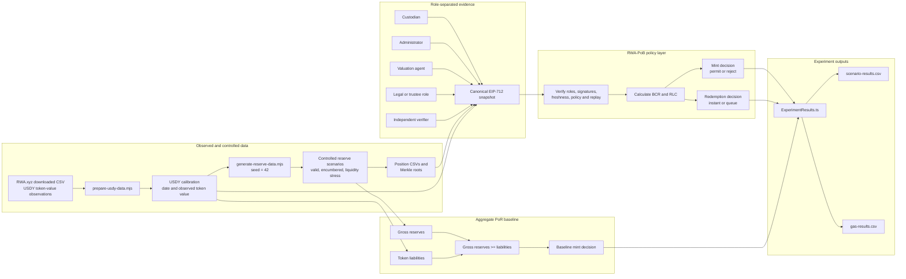

# RWA-PoB: Credential-Based Proof of Backing for Tokenized U.S. Treasuries

[](https://github.com/rischanlab/PoB/actions/workflows/ci.yml)
[](LICENSE)

This repository contains the research prototype and reproducibility package for
**RWA-PoB**, a credential-based proof-of-backing policy framework for tokenized
short-duration U.S. Treasury products.

The prototype compares:

1. **Aggregate Proof of Reserves (PoR):** checks whether reported gross reserves
   cover reported token liabilities.
2. **RWA-PoB:** verifies a common reserve snapshot signed by required
   institutional roles, calculates eligible backing and redemption liquidity,
   and applies explicit minting and redemption policies.

> **Research disclaimer:** This repository is not an audit of USDY, does not
> reconstruct USDY's actual reserve portfolio, and is not production-ready
> financial software. The replay is a historical-data-driven simulation: it
> uses USDY's bridged supply and issuer NAV as published by RWA.xyz (supply =
> Bridged Token Value / NAV), official U.S. Treasury bill rates, and a
> *modelled* reserve portfolio. Daily supply changes are net bridged-supply
> changes, not observed primary-market subscriptions and redemptions.
> Credential states and signers are simulated test accounts.

> **Version 2.0.0 (response to review).** Settlement now reduces eligible
> reserves, each role signs only its own fields, reserve positions can be
> challenged on-chain against the Merkle root, custodian receipts credit
> subscription cash, and the evaluation adds a 1,043-day on-chain replay on real
> data. See [`CHANGELOG.md`](CHANGELOG.md) for the full list, results, and the
> regression test for each review comment.

> **Version 2.2.0 (major revision).** Adds an ablation that isolates each
> feature (`contracts/test/AblationController.sol`), a persistent-controller
> replay and a five-epoch continuity test, executed trust/collusion/liveness
> cases, an off-chain aggregate reconciliation script with omission and
> fabrication cases, the FOBXX disclosed daily flows on one controller,
> `issueWithReceipt` on the token, an encumbrance sweep, and alternative
> accrual assumptions. It implements an **authenticated variable redemption
> price** (token supply and price in every snapshot, unit-denominated mints
> and redemptions, liabilities rounded up and claims rounded down), replays
> USDY's **observed supply and daily NAV** on one controller, and runs
> **five monthly FOBXX filings** (May-Sep 2026) on one controller. 67 tests.
> See [`CHANGELOG.md`](CHANGELOG.md).

## Main contributions implemented

- Role-scoped EIP-712 claims from five required institutional roles (v2):
  - custodian: header + gross reserves;
  - administrator: header + token, pending, and other liabilities, token supply, and redemption price;
  - valuation agent: header + eligible reserves and liquid assets;
  - legal or trustee role: header (reserve root); and
  - independent verifier: the complete snapshot.
  The header is epoch, as-of time, expiry, policy hash, and reserve root.
- Permissionless position-level consistency challenge: a Merkle proof of a
  committed position that breaks the eligibility rules suspends the snapshot
  (v2). The contract does **not** check that positions add up to the signed
  totals or that the file is complete; `scripts/reconcile-snapshot.mjs` does
  that off-chain (v2.2).
- Custodian-signed subscription receipts, credited atomically with the mint
  (`authorizeMintWithReceipt`, and `RWABackedToken.issueWithReceipt`, v2.2).
- Settlement reduces liquid, eligible, and gross reserves (v2 fix).
- A canonical snapshot containing:
  - reporting epoch and timestamps;
  - reserve Merkle root;
  - policy hash;
  - gross and eligible reserves;
  - liquid assets;
  - token liabilities;
  - pending redemptions; and
  - other liabilities.
- Signer-role, freshness, expiry, policy-version, and replay checks.
- Liability-continuity checks between accepted snapshots.
- Backing Coverage Ratio (BCR).
- Redemption Liquidity Coverage (RLC).
- Mint authorization and redemption disposition (`instant` or `queue`).
- Pending-redemption accounting until settlement.
- Aggregate PoR baseline for controlled comparison.
- Deterministic reserve scenarios using seed `42`.
- Authenticated redemption price (v2.2): each snapshot carries `tokenSupply`
  and `redemptionPrice`; it is accepted only if
  `tokenLiabilities == ceil(tokenSupply * price)`. Mints and redemptions are
  in token units; a mint adds `ceil((U+u)P) - ceil(UP)` to liabilities and a
  redemption fixes a claim of `floor(uP)` at request.
- Historical-data-driven simulated replay: 1,043 days of observed USDY
  bridged supply and daily NAV on one persistent controller (v2.2), a
  modelled portfolio priced daily from U.S. Treasury bill rates, every
  decision made on-chain; the earlier inferred-flow mode is kept as a
  sensitivity, with ablation, encumbrance sweep, accrual and persistence
  variants.
- CSV outputs for policy decisions and gas usage.

## Architecture



## Financial metrics

The prototype calculates the Backing Coverage Ratio as:

$$
\mathrm{BCR}
=
\frac{\text{Eligible reserves}}
{\text{Token liabilities}
+\text{Pending redemptions}
+\text{Other liabilities}}
$$

A mint is permitted only when the post-mint BCR meets the configured
threshold. The controlled scenarios use a minimum BCR of **105%**; the
real-data replay uses **101%**.

For a proposed redemption request, the experiment calculates:

$$
\mathrm{RLC}
=
\frac{\text{Liquid assets}}
{\text{Pending redemptions}
+\text{Proposed redemption}}
$$

The current experiment uses a minimum RLC of **100%**. A redemption is
settled immediately when this threshold is satisfied; otherwise, it is placed
in the settlement queue.

## Repository structure

```text
.
├── .github/
│   └── workflows/
│       └── ci.yml
├── contracts/
│   ├── AggregatePoRBaseline.sol
│   ├── PoBPolicyController.sol
│   ├── RWABackedToken.sol
│   └── test/PoBPolicyControllerV1.sol   # submitted version, comparison only
├── data/
│   ├── raw/
│   │   ├── README.md
│   │   ├── treasury/                          # U.S. Treasury bill rates (committed)
│   │   └── rwa-xyz-*.csv                      # ignored by Git
│   ├── input/
│   │   ├── usdy-calibration.json
│   │   ├── usdy-observed-token-value.csv
│   │   └── usdy-scenarios/
│   └── results/
│       ├── gas-results.csv
│       ├── scenario-results.csv
│       ├── real-replay-summary.csv
│       ├── real-replay-gas.csv
│       └── real-replay-daily-baseline.csv
├── scripts/
│   ├── fetch-treasury-bill-rates.sh
│   ├── generate-reserve-data.mjs
│   ├── prepare-usdy-data.mjs
│   └── validate-treasury-bill-rates.py
├── test/
│   ├── ExperimentResults.ts
│   ├── helpers.ts
│   ├── PoBPolicyController.ts
│   ├── RealDataReplay.ts
│   └── V2ReviewFixes.ts
├── CHANGELOG.md
├── CITATION.cff
├── LICENSE
├── REPRODUCIBILITY.md
├── hardhat.config.ts
├── package-lock.json
├── package.json
└── tsconfig.json
```

## Requirements

- Node.js `22.13.0` or later
- npm
- Git
- Visual Studio Code is recommended

The current validated local environment used:

```text
Node.js:  v24.18.0
npm:      11.16.0
Hardhat:  3.11.1
```

Check your environment:

```powershell
node --version
npm.cmd --version
npx.cmd hardhat --version
git --version
```

On PowerShell systems that allow npm scripts, `npm` and `npx` may be used
instead of `npm.cmd` and `npx.cmd`.

## Installation

Clone the repository:

```powershell
git clone git@github.com:rischanlab/PoB.git
Set-Location PoB
```

Install the exact dependency versions recorded in `package-lock.json`:

```powershell
npm.cmd ci
```

Compile the Solidity contracts:

```powershell
npm.cmd run build
```

Hardhat may print:

```text
No contracts to compile
```

when the contracts have already been compiled and have not changed. This is
normal.

## Quick reproduction from committed processed data

The repository commits the processed USDY calibration and deterministic
scenario inputs. The original third-party CSV is not required for this path.

```powershell
npm.cmd ci
npm.cmd run build
npm.cmd run generate:data
npm.cmd run test:unit
npm.cmd run experiment
```

Optional coverage:

```powershell
npm.cmd run coverage
```

The generated experimental outputs are written to:

```text
data/results/scenario-results.csv
data/results/gas-results.csv
```

## Reproduce from the original RWA.xyz download

The original RWA.xyz CSV is intentionally excluded from Git. To reproduce the
data-preparation stage:

1. On RWA.xyz, open Ondo U.S. Dollar Yield (USDY), choose the market-cap
   chart with the measure "Bridged Token Value (Dollar)", and download the
   CSV. It has one column per chain (Ethereum, Solana, BNB Chain, ...).
2. Run:

```bash
node scripts/prepare-usdy-data.mjs path/to/rwa-xyz-usdy-market-caps.csv --until 2026-07-26
```

The script sums the chain columns for each date. The committed series was
produced from the export downloaded on 2026-11-01. The script also accepts the
older Treasury market-cap export (one column per product), from which it reads
the "Ondo U.S. Dollar Yield" column. RWA.xyz revises history from time to time:
an export downloaded in mid-2026 matched to the cent up to 2024-10-28 and
differed by up to 2.9% on some later days.

It writes:

```text
data/input/usdy-observed-token-value.csv
data/input/usdy-calibration.json
```

Then regenerate and evaluate the scenarios:

```powershell
npm.cmd run generate:data
npm.cmd run test:unit
npm.cmd run experiment
```

## Data used in the current experiment

The processed calibration contains:

| Item | Value |
|---|---:|
| Observations | 1,043 |
| First observation | 2023-09-18 |
| Last observation | 2026-07-26 |
| Latest observed token value | $2,161,446,182.114861 |
| Source measure | Bridged Token Value (Dollar), summed across 12 chains |
| Source file | RWA.xyz USDY market-caps export, downloaded 2026-11-01 |

RWA.xyz defines Bridged Token Value (Dollar) as bridged token supply
multiplied by issuer-reported NAV. The series is used as a proxy liability:
it is not an issuer record of legal liabilities, and its daily changes mix
supply, NAV accrual, and bridging adjustments.

## Deterministic scenario assumptions

All scenarios contain 100 generated reserve positions and use seed `42`.

| Parameter | Assumption |
|---|---:|
| Gross reserve target | 115% of observed token value |
| Valid-scenario liquid assets | 10% of observed token value |
| Liquidity-stress liquid assets | 2% of observed token value |
| Encumbered scenario target | Eligible reserves below 98% |
| Other liabilities in experiment | 0.5% of observed token value |
| Test redemption request | 5% of observed token value |
| Minimum BCR | 105% |
| Minimum RLC | 100% |

The controlled reserve fields include market value, haircut, maturity,
encumbrance, legal eligibility, settlement finality, and liquid value.

## Current experimental output

### Scenario generation

```text
Scenario: valid
  Liability date: 2026-07-26
  Token liabilities: $2161446182.114861
  Gross reserves: $2485663109.432090
  Eligible reserves: $2478996062.810477
  Liquid assets: $216144618.211486
  Merkle root: 0xd936203f5b7c8087fb46d1982f5d186f4ceadf1bb78dba8ed1df1880ac2a4463

Scenario: encumbered-assets
  Liability date: 2026-07-26
  Token liabilities: $2161446182.114861
  Gross reserves: $2485663109.432090
  Eligible reserves: $2092768254.902791
  Liquid assets: $216144618.211486
  Merkle root: 0xfaa711c1f81d3dec4c95a5716998de876fd4b879d2ba6e4202b1ec8d8b27863b

Scenario: liquidity-stress
  Liability date: 2026-07-26
  Token liabilities: $2161446182.114861
  Gross reserves: $2485663109.432090
  Eligible reserves: $2478996062.810477
  Liquid assets: $43228923.642297
  Merkle root: 0x46532b1aadf94caaa3c962dea17e2e68d1516d92f1eac50aa98bc43a7dd75437
```

### Unit tests

```text
PoBPolicyController
  ✔ accepts a fresh snapshot signed by every mandatory role
  ✔ rejects a snapshot when a mandatory signature is missing
  ✔ rejects replay of the same signed snapshot
  ✔ shows why eligible reserves are stricter than aggregate PoR
  ✔ queues a redemption when liquid assets are insufficient
  ✔ keeps a redemption as a liability until settlement
  ✔ stops mint authorization after the snapshot becomes stale

7 passing
```

### Policy decisions

| Scenario | Aggregate PoR mint | RWA-PoB mint | Redemption | BCR | Post-request RLC |
|---|---:|---:|---|---:|---:|
| Valid | Accept | Accept | Instant | 114.12% | 200.00% |
| Encumbered assets | Accept | Reject | Instant | 96.34% | 200.00% |
| Liquidity stress | Accept | Accept | Queue | 114.12% | 40.00% |

The encumbered-assets scenario demonstrates the central difference. The
aggregate baseline accepts minting because gross reserves exceed token
liabilities, while RWA-PoB rejects minting because encumbered positions are
excluded from eligible backing.

The liquidity-stress scenario demonstrates that backing adequacy and
short-horizon liquidity are separate. RWA-PoB permits minting based on adequate
backing but queues the tested redemption because liquid assets cover only about
40% of the request.

### Gas usage

| Operation | Gas used |
|---|---:|
| `submitSnapshot:valid` | 438,717 |
| `baselineReport:valid` | 94,701 |
| `submitSnapshot:encumbered-assets` | 211,387 |
| `baselineReport:encumbered-assets` | 37,801 |
| `submitSnapshot:liquidity-stress` | 214,175 |
| `baselineReport:liquidity-stress` | 37,801 |

## Historical-data-driven simulated replay (v2, extended in v2.2)

```bash
npm run validate:treasury   # 750 rows, 4,864 checks, 0 mismatches
npm run experiment:real     # full 1,043-day replay, 39 configurations
```

`test/RealDataReplay.ts` replays USDY day by day against a modelled 2% cash +
26-week Treasury-bill ladder priced from the official daily bill curve. Each
snapshot, mint (with a custodian receipt), redemption, and settlement goes
through the deployed controller.

**Supply mode (primary, 13 runs `supply-*`).** Bridged supply = token value /
NAV (exact, `data/input/usdy-observed-supply.csv`); daily supply changes are
minted or redeemed in token units on one persistent controller, and each
weekly snapshot attests the controller's units and that day's NAV as the
redemption price.

| Supply-mode run | PoB mints (of 504 increases) | Rejected BCR/RLC | Queued (of 309) | BCR range | Unsafe | Price lag max pp / unsafe |
|---|---:|---:|---:|---|---:|---:|
| Baseline (3%, weekly, T+1) | 474 | 0/30 | 15 | 102.56-103.91 | 0 | 0.089 / 0 |
| Buffer 1.5% | 474 | 0/30 | 15 | 101.06-101.78 | 0 | 0.087 / 1 |
| Daily snapshots | 410 | 0/94 | 67 | 102.59-104.24 | 0 | 0.000 / 0 |
| Encumbered 2% / 3% / 4% | 48 / 5 / 0 | | | | 0 | |
| A1 / A2 / A3 | 450 / 322 / 474 | 54/0, 54/146, 0/30 | 0 / 94 / 15 | | 0 | A1: 1 |

"Price lag" re-values liabilities at the day's NAV instead of the last
attested one: between weekly snapshots post-mint BCR was at most 0.089 pp
lower, and in two runs one mint each would have been just below 101% on that
basis. PoR accepted all 504 increases in every run.

**Inferred-flow mode (sensitivity, 26 runs).** Net flows inferred from the
token value minus an estimated accrual, at `P_red = 1`. Only 61% of inferred
inflow days are supply-increase days. Results:

| | Aggregate PoR | RWA-PoB |
|---|---:|---:|
| Mints accepted (of 343 inferred inflow days) | 343 | 327 |
| Mints accepted, 4% encumbered (hypothetical stress) | 343 | 0 |
| Unsafe mints (post-mint BCR < 101%), all 39 runs | not checked | 0 |
| Inferred mints satisfying the *reconstructed* v1 rule below threshold, 4% encumbered | | 43 (USD 9.60 m) |

Ablation (same data and thresholds):

| Policy | Mints | Rejected BCR/RLC | Queued | Max claim age | Mints at 4% | Snapshot gas | One compromised key |
|---|---:|---:|---:|---:|---:|---:|---|
| Gross PoR | 343 | - | - | - | 343 | - | not prevented |
| A1 eligible BCR, single attestor, no RLC, no receipts | 289 | 54/0 | 0 | 61 | 0 | 330,693 | not prevented |
| A2 + RLC policy | 214 | 54/93 | 78 | 75 | n/r | 328,008 | not prevented |
| A3 + receipts | 327 | 0/16 | 7 | 37 | n/r | 330,867 | not prevented |
| Full RWA-PoB (role-scoped) | 327 | 0/16 | 7 | 37 | 0 | 418,289 | prevented |

Encumbrance sweep (PoB mints): 0% 327, 1% 327, 2% 26, 2.5% 12, 3% 6, 3.5% 3,
4% 0. Accrual: 91-day median 354 of 370 inferred inflows, T-bill-based 475
of 492; a 7-day median breaks the flow inference (reported as fragility).
Persistent controller: 327 accepted, 0 conservation violations.

All configurations and the model assumptions are in
[`CHANGELOG.md`](CHANGELOG.md). Without the `RWA_POB_REAL_REPLAY=1` flag
(as in `npm test` and CI), the replay runs for 70 days as a smoke test.


## Real position-level snapshot (v2.1)

```bash
npm run prepare:franklin          # N-MFP3 XML -> data/input/franklin-fobxx/holdings.csv, fund.json
npm run build:franklin            # positions.csv, tree.json, snapshot.json (Merkle root)
npm run experiment:real-positions # on-chain verification, policy and challenges
```

The reserve tree is built from a real filing: the Franklin OnChain U.S.
Government Money Fund (FOBXX, the fund behind the BENJI token) Form N-MFP3
for 30 September 2026, committed in `data/raw/franklin/` (SEC EDGAR, public
record). It has 85 positions: 83 securities (Treasury bills and notes, agency
debt, 4 tri-party repos with 38 collateral lines), cash, and other assets.
Values, maturities and the daily/weekly liquidity flags are the fund's own;
the haircut schedule (0/10/25/50 bps by days to final maturity) is a stated
policy assumption. The 83 CUSIP/value pairs match the fund's published
holdings PDF to the dollar.

| | Result |
|---|---:|
| Merkle root | `0x8f8a056a...56595c1` |
| Positions verified on-chain | 85 of 85 (proof length 6-7) |
| Gross / eligible reserves (USD m) | 697.84 / 695.75 |
| Liquid within 7 days (USD m) | 486.96 (fund-reported WLA 487.47) |
| Token liabilities + other liabilities (USD m) | 667.97 + 30.03 |
| BCR after haircuts | 99.68% |
| RLC against the largest 5-day redemptions in Sep 2026 (USD 24.27 m) | 2,006.51% |
| Mint of USD 1 m, minBCR 100% | rejected (with or without receipt) |
| Mint of USD 1 m, minBCR 99.7 / 99.6 / 99.5% (sensitivity) | no receipt: R / R / A; with receipt: R / A / A |
| BCR after a USD 100 m receipt-backed mint | 99.72% (a receipt cannot lift BCR above 100%) |
| Leaves vs signed totals vs filing (`npm run reconcile:franklin`) | reconciled |
| Disclosed Sep-2026 daily flows on one controller, minBCR 99.5% / 100% | 21 / 0 of 21 subscription days accepted |
| `submitSnapshot` gas | 459,484 |

A 1:1 government money fund has no over-collateralisation and carries its
securities at amortised cost, so at market value with haircuts its BCR is just
below 100%. The thresholds below 100% are researcher-selected sensitivity
values. Rule 2a-7's one-half-of-one-percent figure (17 CFR 270.2a-7(g)(1)(i))
is a share-price deviation that triggers board consideration; it is not a
coverage ratio for issuing tokens.

Reconciliation cases (`real-position-reconciliation.csv`): inflated totals
(R1) and an omission with unchanged totals (R2) are flagged by comparing
leaves with signed totals; an omission or fabrication with consistent totals
(R3, R4) only by comparing with the filing. All are accepted on-chain.

Five tampered versions of real positions are each caught by a permissionless
challenge that suspends minting (`data/results/real-position-challenges.csv`,
66,000-67,556 gas): a repo pledged elsewhere but counted, receivables counted
as eligible, an unsettled bill counted, a haircut skipped, and liquid value
above eligible value. A non-weekly-liquid note reported as liquid is *not*
caught, because the contract does not test liquidity classification; this
is listed as a limitation. A simple maturity rule would not fix it: 35 of the
fund's 40 weekly-liquid positions (USD 288.90 m) mature after 7 days (up to
365), mostly Treasuries that Rule 2a-7 counts as weekly liquid, so the rule
would suspend a sound fund. The leaf would need the regulatory liquidity
class. The tampering tests show rule coverage on real positions; they are
not a detection rate, since the rules and the tampering were written together.

### Five monthly filings on one controller (v2.2)

```bash
npm run build:franklin-monthly    # 31 May, 30 Jun, 31 Jul, 31 Aug 2026 filings
npm run experiment:fobxx-monthly  # data/results/fobxx-monthly.csv
```

The 31 May - 30 Sep 2026 filings become five epochs of one controller
(minBCR 99.5%). Between month ends the controller books the next month's
disclosed daily flows; each month-end snapshot attests the filed shares as
token supply and is accepted only if the controller's unit count matches.

| Month end | Leaves | Securities in / out | Subs / reds (USD m) | Flow vs shares residual (USD) | Shares (USD m) | BCR |
|---|---:|---:|---:|---:|---:|---:|
| 31 May | 77 | - | - | - | 813.50 | 99.77% |
| 30 Jun | 83 | 28 / 22 | 48.60 / 108.86 | -71.30 | 753.25 | 99.71% |
| 31 Jul | 83 | 12 / 12 | 15.69 / 48.00 | 24.96 | 720.93 | 99.76% |
| 31 Aug | 84 | 20 / 19 | 16.92 / 51.22 | 20.32 | 686.64 | 99.70% |
| 30 Sep | 85 | 19 / 18 | 23.40 / 42.07 | 23.21 | 667.97 | 99.68% |

Every leaf verifies and every month reconciles. Each month the filed share
change differs from the filed daily flows by a few dollars; the continuity
check rejects the first submission and the residual is booked as an explicit
adjustment before resubmission.

## View result files in PowerShell

Display the policy decisions:

```powershell
Import-Csv data\results\scenario-results.csv |
    Format-Table `
        scenario,
        liabilityDate,
        baselineMint,
        pobMint,
        redemptionDisposition,
        bcrPercent,
        postRequestRlcPercent `
        -AutoSize
```

Display gas usage:

```powershell
Import-Csv data\results\gas-results.csv |
    Format-Table operation,gasUsed -AutoSize
```

## Tests covered

67 tests pass (`npm test`; Hardhat also lists `test/helpers.ts` as a passing
file, so it prints 68). The per-file inventory is in
[`REPRODUCIBILITY.md`](REPRODUCIBILITY.md). They include 14 v2 regression
tests in `test/V2ReviewFixes.ts`, 4 redemption-price tests in
`test/VariablePrice.ts`, 5 tests on the real FOBXX position file (including
aggregate reconciliation and the 100/80/90 example), the FOBXX daily-flow and
five-month tests, a five-epoch persistent-controller test, and 7 trust-model
tests. The controller unit tests verify:

- acceptance of a complete and fresh snapshot;
- rejection of a missing mandatory signature;
- snapshot replay rejection;
- eligible-reserve enforcement;
- liquidity-based redemption queuing;
- pending liability until settlement; and
- mint suspension after snapshot staleness.

The evaluation contains three deterministic scenarios, the real-data
replay, and the real position-level snapshot. It is not a formal security evaluation.

## Reproducibility guarantees

The following are committed or pinned:

- dependency versions through `package-lock.json`;
- Solidity compiler configuration;
- synthetic seed `42`;
- position count `100`;
- processed USDY observations;
- calibration metadata;
- generated scenario definitions;
- Merkle roots;
- experiment scripts; and
- CSV result files.

To verify deterministic generation, run the following twice and compare the
Merkle roots and result CSVs:

```powershell
npm.cmd run generate:data
npm.cmd run experiment
```

For a paper or archived release, cite a fixed Git tag or release rather than the
moving `main` branch.

## Continuous integration

GitHub Actions runs the following on every push and pull request:

```text
npm ci
npm run build
npm run generate:data
npm run validate:treasury
npm run reconcile:franklin
npm test
npm run experiment
npm run experiment:trust
npm run experiment:fobxx-flows
```

The resulting CSV files are uploaded as a workflow artifact.

The CI workflow does not run `prepare:usdy` because the original raw
third-party CSV is not stored in the repository.

## Limitations

- Signed credentials prove attribution and integrity, not the truth of
  off-chain statements.
- The position-level reserve portfolio is synthetic in the scenarios and
  modelled (cash + Treasury-bill ladder priced from real rates) in the replay.
  The real FOBXX evidence is five month-end filings; intra-month positions
  are not observed, and the haircuts are a policy assumption.
- The challenge rules do not check liquidity classification, so a
  non-weekly-liquid position reported as liquid is not caught on-chain.
- The contract does not check that positions sum to the signed totals or that
  the position file is complete; omissions with consistent totals are
  visible only against an external record (off-chain).
- The redemption price is attested per snapshot and is stale in between;
  the replay measures the effect (at most 0.089 pp of BCR weekly) but no
  accrual-aware price is implemented.
- USDY daily supply changes are net bridged-supply changes from a market-data
  aggregator; no public primary-market record was available to validate them.
- Five signer accounts are not proof of five independent institutions;
  compromised governance and collusion are not resisted.
- Institutional signers are simulated test accounts.
- The experiment does not reconstruct or audit USDY's actual holdings,
  encumbrances, custody accounts, or settlement records.
- The current prototype does not provide a complete formal security proof.
- Gas results are local Hardhat measurements and do not represent a fixed fiat
  deployment cost.

## Security and responsible use

Do not use real private keys, seed phrases, or production credentials in this
repository. Local environment files, raw third-party data, build artifacts, and
dependencies are excluded through `.gitignore`.

## Citation

Citation metadata are provided in [`CITATION.cff`](CITATION.cff). 

## License

This prototype is released under the MIT License. See [`LICENSE`](LICENSE).
